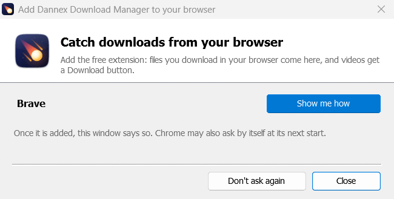
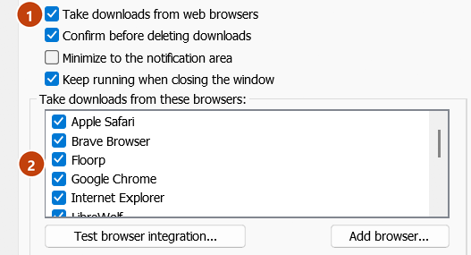
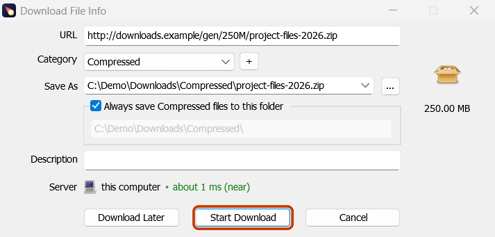
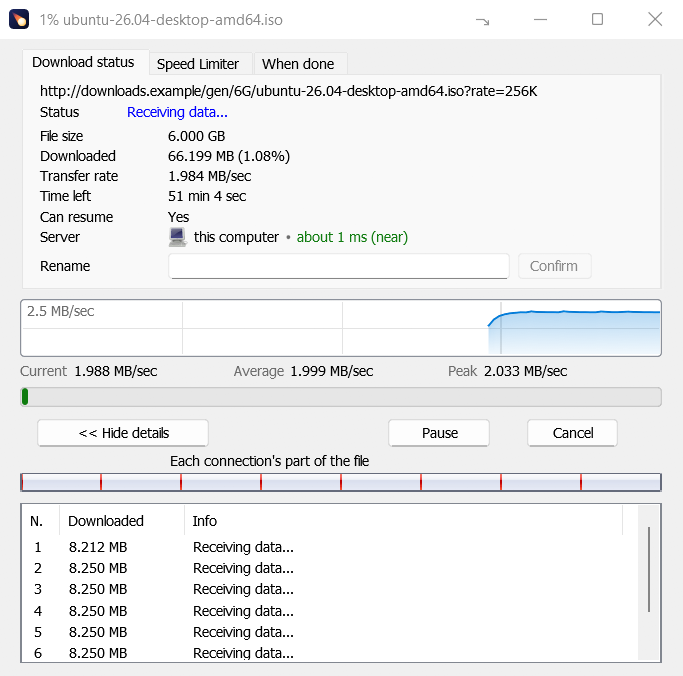
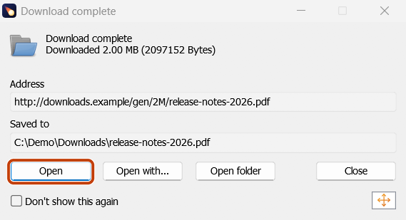
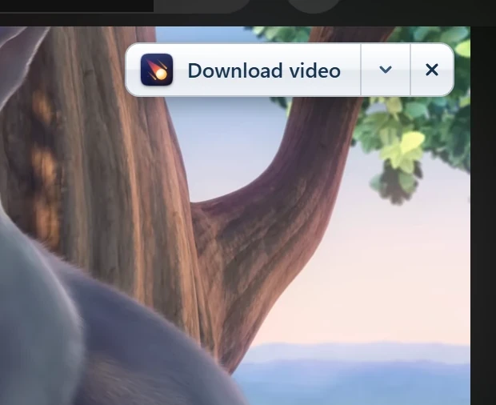
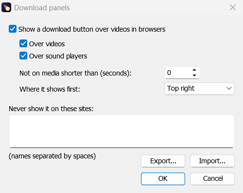
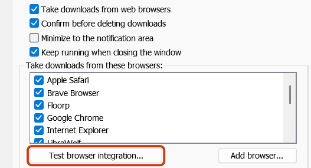

# Browser integration

[← Back to docs index](README.md)

With the DDM extension, clicking a download link in your browser hands the download to DDM. DDM gets the address together with the page it came from (the referrer), your cookies for the site and the browser's User-Agent, so downloads that need you to be signed in still work. It also gets the address the browser's own download had reached: when a site refuses DDM the link itself (a one-time link the browser has already used, or a site that lets only browsers ask for its links), DDM goes on from there once, without your cookies if it is another site. When a site's bot check (Cloudflare's, for one) or its refusal of programs (FileHippo's *412 Precondition Failed*) turns DDM's own connection away, DDM asks once more connecting the way your browser does (the same handshake, settings and order of headers), with your browser's User-Agent and its cookies for that site only, and downloads on that one connection; your proxy, network adapter and speed limits apply as usual. It solves no challenge: a site that still wants one answered refuses again, and DDM says *this site lets only browsers through*, with a way to hand the download back to the browser (see [A site that lets only browsers through](#a-site-that-lets-only-browsers-through)).

The extension works in **Google Chrome**, **Microsoft Edge**, **Brave**, **Opera** and **Vivaldi**, in **Firefox** 140 or later, and in **Safari** 17 or later on a Mac (see [Safari](#safari-macos)).

Browsers built on them work too: Chromium and Helium take the extension as Chrome does, Brave Origin as Brave does, Zen and LibreWolf as Firefox does. On Windows, Zen has a bug of its own (see [The browser and DDM aren't connected](browser-help.md#not-installed)).

## Set it up

Browser integration has two parts: a small helper program that the browser talks to, and the extension itself.

1. Install DDM with the setup and keep **Set up browser integration (Chrome, Edge, Brave, Firefox)** ticked. This registers the helper. (The portable copy can't do this; see [Portable mode](portable.md).) On Linux and macOS DDM registers it itself, each time it starts, for the browsers installed then.
2. Add the extension to each browser you use, as below. Dannex's extension isn't in the browsers' stores yet (its listings are on their way), so it comes with DDM, in the `extension` folder where DDM is installed, and as its own download with every release. Until a browser's extension has reached DDM, DDM's **Add Dannex Download Manager to your browser** window opens at each start: it lists the browsers it found, and **Show me how** opens these steps (once a store lists it, **Add the extension** opens its page there instead). **Don't ask again** stops the window.


*DDM's own window lists each browser it found, with the way to add the extension to it.*

### Firefox

Firefox 140 or later is needed. Firefox installs only add-ons Mozilla has signed, and Dannex's add-on isn't on addons.mozilla.org yet. Until it is, its file is `extension\ddm-firefox.xpi` in DDM's folder (and `...-extension-firefox.xpi` with every release):

- **Firefox Developer Edition, Nightly or ESR:** open `about:config`, set `xpinstall.signatures.required` to `false`, then open `about:addons`, click the gear, **Install Add-on From File…**, and choose the file.
- **Any Firefox, until it closes:** open `about:debugging#/runtime/this-firefox`, click **Load Temporary Add-on…** and choose the same file.

Once it is listed on addons.mozilla.org, **Add to Firefox** on its page installs it for good, and Firefox keeps it updated; Zen and LibreWolf install it from the same page.

### Chrome, Edge, Brave, Opera and Vivaldi

Load the extension by hand (Dannex's listing in the Chrome Web Store is on its way; once it is there, DDM's **Add Dannex Download Manager to your browser** window opens its page in each browser, where **Add to Chrome** installs it and the browser keeps it updated; in Edge the button is **Get**, after **Allow extensions from other stores**). Its files are in the `extension` folder where DDM is installed: `%LOCALAPPDATA%\Programs\Dannex Download Manager\extension` if you installed it for yourself, or `Program Files\Dannex Download Manager\extension` if you installed it for everyone. Every release also has them as their own download, `...-extension-chromium.zip` (unzip it first).

1. Open the extensions page: `chrome://extensions`, `edge://extensions` or `brave://extensions`.
2. Turn on **Developer mode**.
3. Click **Load unpacked** and choose the `extension\chromium` folder.

**Dannex Download Manager** appears in the list. Leave it turned on. Pin its button to the toolbar to see at a glance whether the browser reaches DDM.

### Helium

In [Helium](https://helium.computer/), load the extension by hand as above (`chrome://extensions` works in Helium too). Once Dannex is in the Chrome Web Store, Helium installs it from there: click **Add to Chrome**. Helium fetches extensions through its own services, so this works only while they're allowed. If Helium says **Extension downloads are disabled**, open `helium://settings/privacy/services` (**Settings → Privacy and security → Helium services**), turn on **Allow connecting to Helium services** and **Proxy extension downloads and updates**, and click **Add to Chrome** again. With those off, load the extension by hand, as above.

DDM's setup registers the helper where Helium looks for it, on Windows, Linux and macOS. Once the store lists it, on Linux and macOS DDM also offers the extension to Helium, through Helium's own services, so with them allowed it arrives by itself at Helium's next start (on macOS Helium asks first: **New extension added** in its menu, where you turn it on). The Linux packages (.deb, .rpm) leave that to the window below, writing nothing in your home folder. On Windows Helium can't be offered the extension this way: DDM's **Add Dannex Download Manager to your browser** window opens the store's page in Helium when Helium was installed with its setup; Helium from its zip isn't found there, so open the store's page in it yourself. Helium presents itself as Google Chrome, on purpose, so in **Options → General → Take downloads from these browsers** it is **Google Chrome**.

### Safari (macOS)

The Mac app carries the Safari extension: there is nothing to download. Safari 17 or later and macOS 14 or later are needed.

1. Drag DDM to Applications and start it once. DDM's **Add Dannex Download Manager to your browser** window lists Safari: **How to Add** shows the steps below.
2. In Safari open **Settings → Extensions** and tick **Dannex Download Manager**. Click **Always Allow on Every Website**: the extension needs to read the site to pass your sign-in on.
3. While the app is not notarized by Apple (the experimental builds are not), Safari lists the extension only with unsigned extensions allowed: **Settings → Advanced** → **Show features for web developers**, then **Settings → Developer** → **Allow unsigned extensions**. Safari forgets that setting each time it quits.

Safari lets an extension neither see nor stop the browser's downloads, so what works differs from the other browsers:

- **Works as in the other browsers:** the right-click items, the button over videos, the toolbar button, **Alt**-click, DDM starting by itself, and every rule in Options.
- **A click on a link to a file type DDM takes** goes to DDM. A download the page starts by itself (a script, or a link with no file name in its address that the server answers with a file) stays with Safari: use right-click → **Download with DDM** for those.
- **Not available:** sharing the browser's proxy or VPN, and a download from a form.

### From the plain zip

The `-x64.zip` copy has no installer, but you can register the helper yourself. Open a command prompt in DDM's folder and run:

```
dannexdownloadmanager-nmhost.exe --register
```

This is for your Windows account only. `--unregister` undoes it. Then load the extension as above, from the zip's `extension` folder.

## What it takes

When you click a download, the extension checks DDM's Options:

- **Options → General → Take downloads from web browsers** must be on. Turn it off to send nothing to DDM.
- **Options → General → Take downloads from these browsers** must have your browser ticked.
- **Options → File types → Take these file types from the browsers** must list the file's type. The list starts with the usual ones: ZIP, RAR, 7Z, EXE, MSI, ISO, DMG, DEB, RPM, APPIMAGE, MP3, MP4, MKV, WEBM, PDF, AI models such as GGUF and SAFETENSORS, 3D files such as GLB and STL, and many more. Anything else can be added to the list.
- **Options → File types → Leave downloads from these sites to the browser** must not list the site. Names are separated by spaces, and `*` matches any part, as in `*.update.microsoft.com`. **Edit list ...** below it lists whole addresses to leave alone, one per line (`https://example.com/private/*`).
- **Options → File types → Don't take files smaller than** leaves small files (a receipt, an icon) to the browser. 0 takes any size.
- The extension must be allowed to read the site. When you limit it to some sites (or **On click**), it can't pass your sign-in on, so it leaves those sites' downloads to the browser.


*1 must be on, and 2 your browser ticked.*

When the browser keeps a download, the extension's status page (right-click its toolbar button → **Help**) says which of these left it there, with the file's name, and DDM's log has a line for each one (`logs\ddm.log` in [DDM's data folder](crash-reports.md#where-reports-are-kept)).

Both the address you clicked and the one its redirects led to are checked, so a site you excluded stays excluded even when it sends you to another server. Everything else stays with the browser. Changes in Options reach the browser within a minute; you don't need to restart it.

When DDM takes a download, it gets the browser's file name, size and type with it, so **Download File Info** shows them at once without asking the server again. A download from a form (a button that posts and gets a file back) is posted again by DDM with the form's data; a form that sends a file stays with the browser.

When DDM takes a download, the browser's own copy is cancelled and removed from the browser's download list. In Firefox and the browsers built on it (Waterfox, Zen, LibreWolf), DDM takes it as soon as the server answers, before the browser asks *What should … do with this file?*: for a file DDM takes, that question never shows (Waterfox asks it for every new type of file). Files DDM doesn't take get the question as before. **Download File Info** opens in DDM (unless you turned it off in **Options → Downloads**). Cancelling there doesn't hand the download back to the browser.

<!-- steps -->

1. 
   *Click a download link in the browser: Download File Info opens in DDM.*
2. 
   *Start Download: the progress window shows it coming in.*
3. 
   *Download complete: Open the file, or Open folder.*

Downloads from a private window use that window's cookies, never the normal ones, and aren't kept in DDM's list after it closes.

Files DDM downloads from the browser are marked as coming from the internet, as the browser marks its own: Windows checks a program with SmartScreen before it runs and Office opens a document in Protected View.

## Files the browser would open

A PDF, a song or a video that the browser would show or play itself goes to DDM too, when its type is in **Options → File types** (not on the excluded sites). To turn this off, untick **Also take files the browser would open** in **Options → General → Keys...**. This needs a Chromium browser (Chrome, Edge, Brave, Opera, Vivaldi) version 128 or later, or Firefox.

## The toolbar button

The extension does almost nothing you can see: everything else is set in DDM's own **Options**. A click on its button turns taking downloads off, and another click turns it back on. It is one switch for the whole browser: every tab, and the tabs you open later, go by it.

- **On**: the button is in colour, with no badge, as any button. Its tooltip says *Dannex Download Manager is on. Click to turn it off.*
- **Off**: the button is grey, with a small **X** in its corner and **OFF** on it. Every download stays with the browser until you click it again. (Right-click → **Download with DDM** and the keys that force a link still send that one link to DDM: you asked for it.)
- **DDM can't be reached**: the button is grey with a red **!**. A click opens the extension's status page instead of switching anything: in a sentence or two it says what is wrong and the one thing to do, offers DDM's download for your system when DDM isn't installed, and turns into **Dannex Download Manager is installed** by itself once DDM answers. See [The browser and DDM aren't connected](browser-help.md) for every case.

Point at the button: its tooltip says which of these it is, and what a click does.

Right-click the button for:

- **Don't take downloads from this site**: adds the current site to DDM's excluded sites. A green **✓** shows on the button for a moment.
- **Help**: the status page: **Dannex Download Manager is installed** with its on/off switch (the same as the click), or what is wrong; and what else is worth knowing (the browser limiting the extension's site access, private windows, an update, the last download the browser kept and why). Its version is small at the bottom, beside **Help** and **Support DDM** (the maintainer's GitHub Sponsors page).

Chrome, Edge, Brave, Opera and Vivaldi add their own **Options** item to that menu; in Firefox it's **Manage Extension** → **Options**. The extension's options page holds only **Send downloads to Dannex Download Manager** (the same switch as the click) and, under **More**, the two things only the extension can do: **Download through this browser's VPN or proxy** (see below) and **Send downloads to**: this computer, or Dannex Download Manager on another computer. When DDM can't be reached, it says so there, with **See what to do** for the status page.

In Safari the toolbar button's click works the same way, but Safari gives an extension's button no right-click menu: open **Safari → Settings → Extensions → DDM Integration Module → Settings** for the options page.

## A VPN or proxy extension

A VPN or proxy extension is a proxy for the browser only. Switch on **Download through this
browser's VPN or proxy** in the extension's options page, under **More** (right-click its toolbar
button → **Options**; it's off as installed), and
DDM downloads what it takes from the browser through the same proxy (with **Options → Proxy /
Socks → Use the browser's proxy for the downloads it hands over**, on by default; see
[Options](options.md#proxy--socks)). Switched off, the extension reads nothing of the browser's
proxy.

- **Firefox** asks you once, at the switch, to allow the extension to read the browser's proxy;
  switching it off takes that permission back. DDM gets the proxy the browser's own request for
  the file took, including the ones a VPN extension picks for each request.
- **Chrome, Edge, Brave, Opera and Vivaldi** can't ask for that permission at the switch, so the
  extension has it from the install (Chrome counts it under the access to every site the extension
  already asks for, so it adds no line to the install prompt and the update asks for nothing new).
  The switch asks nothing. DDM gets the browser's effective proxy, whoever set it (a VPN or proxy
  extension, a policy, the command line): a fixed server for the download's scheme (`http`,
  `https`, `socks4`, `socks5`), unless the address is on its bypass list, or its proxy auto-config
  script (by its address or inline). With no proxy, or the system's, nothing is sent and DDM goes
  by its own Options. A QUIC proxy can't be shared.

In both, the proxy's login is never read: a proxy that asks for the VPN extension's own login
can't be shared, and the download says so rather than going without it.

## Videos a page plays {#media-on-this-page}

Some pages play a video without a link to it, and some players hide it from the download button
too. The extension notes what the tab's players load (HLS and DASH streams, the way most sites play
long videos, and video and sound files), so you can still save it:

- **The button over the video** sends the stream its player loaded ([below](#the-download-button-over-videos)).
- **Right-click the video → Download with DDM** sends the same, for a player with no address of its
  own.
- **Right-click the page → Download all videos and audio with DDM** opens, in Link grabber, the
  page's players and links to such files, and the files its players played without naming them.
- In DDM, **Tasks → Download video from a page** takes the page's address.

Start the video first: the extension notes what the page loads as it plays. A stream whose address
doesn't end in `.m3u8` or `.mpd`, served as plain text, is found too: when you press the button over
its player (or right-click it), the extension reads the first few kilobytes of what that player
fetched to recognise it. Nothing is read until you ask. Pieces of a stream (its segments) are never
sent. A copy-protected stream (DRM: Widevine, PlayReady, FairPlay, as most paid streaming services
use) can't be saved: no tool may break that protection, and DDM doesn't try; the button over such a
video says so.

This needs nothing more from you: the extension already sees what the browser downloads in order
to hand downloads over. What it notes stays in the browser's memory and is forgotten when the tab
goes to another page or the browser closes.

## Right-click: Download with DDM

Right-click a link, a video, a sound or a picture and choose **Download with DDM**. DDM downloads it whatever its type: you asked for it, so the file types list and the excluded sites don't apply here (they only decide which downloads DDM takes over by itself). A video that plays as a stream goes to the **Download video** window with the stream its player loaded (HLS or DASH), as the [button over videos](#the-download-button-over-videos) sends it, with your cookies for the stream's server and the page as the referrer.

Select part of a page and right-click it for **Download selected links with DDM**, or right-click the page for **Download all links with DDM**: the links open in **[Link grabber](link-grabber.md)**, sorted into packages, where you tick the ones you want. Right-click the page for **Download all images with DDM** (each picture at the largest size the page offers) or **Download all videos and audio with DDM** (the page's players and links to such files, and the files its players played): they open in Link grabber the same way.

If DDM can't be reached when you choose one of these, the help page opens at the section that explains why.

**Options → General → DDM's commands in the browsers' right-click menu → Edit...** chooses which of these five the browser's menu shows. A browser changes its menu when you next switch to it.

## The download button over videos


*The button over a video. Drag it where you like; it stays there.*

Point at a video on a web page and a small **Download video** button appears at its edge. Click it and a menu opens over the video: DDM looks up the qualities it can download and lists them with their sizes. Pick one and it downloads at once, with only its progress window; DDM's main window stays where it is (with **Otherwise, add them to the queue without starting** on in Options, it goes in the queue instead). **Open in DDM...** at the bottom of the menu opens the **Download video from a page** window instead. DDM must be running for the menu: when it isn't, or for another DDM you send downloads to, a click opens that window directly. It takes the video you clicked: its own file when it plays one, or the stream the player loaded (HLS or DASH), else the page. When the button can't tell which one you mean, open the video's own page and use the button there, or paste that page's address in DDM's **Tasks → Download video from a page**. Embedded players work too, and your sign-in for the site, the page that embeds the player and your browser's User-Agent go with it, so videos for members, or that play only on the site that embeds them, can be downloaded. Sound players get the button too.

It stays out of the way: it shows only while you point at a video (or the player has the keyboard's focus; **Tab** then moves to the button), fades when the pointer rests, and leaves out small videos and short muted loops (animated pictures, backgrounds). In fullscreen it follows the video when the player allows it. On a copy-protected video (DRM) it says that the video can't be saved.

- **Move it**: drag it anywhere along the video's edge; it snaps to the nearest edge and stays there on that site.
- **Its menu** (the arrow next to it): **Hide on this video**, **Never on** the site (DDM remembers the site, without its `www.`, so its other addresses such as `m.` are covered too), and **Button settings...**, which opens DDM's Options (when DDM can't be reached, the button says so).
- **Its settings**: **Options → General → DDM's download button over videos in browsers → Edit...**: turn it off; show it **Over videos**, **Over sound players**, or both; leave it off media shorter than so many seconds (the browser knows a video's length once its player has loaded it, and shows the button until then); choose **Where it shows first** (top right unless you choose another corner; dragged elsewhere on a site, it stays there on that site); and see or edit the sites it never shows on. **Never on** in the button's menu adds to that list, and a site added there while Options is open is kept when you click OK.


*Options → General → Edit...: what the button shows over, from what length, where, and the sites it never shows on.*

The button follows the rest of the integration: it doesn't show when **Take downloads from web browsers** is off or the browser is unticked.

## Keys to force or prevent capture

Hold **Alt** while clicking a link to let the browser download it instead of DDM. In Firefox, Alt+click saves a link only when its `browser.altClickSave` setting is on (in `about:config`); otherwise right-click the link and choose **Save Link As...**, which the browser keeps.

Hold **Ctrl+Alt** while clicking a link to have DDM download it whatever its type, as **Download with DDM** in the right-click menu does: a page, a picture, a file type Options leave to the browser. Neither the page nor the browser does anything else with that click (no tab opens).

Both are set in **Options → General → Keys...**: each can be **None**, Alt, Ctrl, Shift, or two or three of them together, and the two must differ. They count exactly as held: with Alt chosen, an Alt+Shift click is an ordinary one. Ctrl+Alt is the default for forcing because nobody makes that click for anything else: a browser opens a tab for Ctrl, a window for Shift and downloads for Alt, and on Windows Alt+Shift switches the keyboard layout. A key chosen to leave links to the browser keeps the browser's own meaning (Shift still opens a new window, which downloads the link); a key chosen to force a link replaces it. On a Mac, Ctrl in Options is the Command key (⌘), since a Control-click opens the right-click menu there: Command+Option forces a link. A change applies once the browser has asked DDM again, which it does when you switch back to it. The **Keys...** window also holds **Also take files the browser would open**.

To keep a site's downloads in the browser for good, right-click the toolbar button → **Don't take downloads from this site**, or add the site to **Leave downloads from these sites to the browser**. To keep a file type in the browser, take it off the file types list.

## A site that lets only browsers through

Some sites' bot checks (Cloudflare's challenge, Akamai's edge) let only a browser through, even after DDM asked once more the way your browser connects. DDM then says *this site lets only browsers through* and offers **Download with the browser**: a button in the download's progress window, and an item in its right-click menu in the list. It's still there after DDM restarts.

It opens the download's address in the browser the download came from, or in your default browser when DDM doesn't know which one it was (a link you added in DDM yourself) or doesn't find it (on Linux, a Flatpak or Snap browser). Answer the site's check there if it asks for one. When the browser starts the download, its extension offers it to DDM as usual, and DDM leaves it to the browser: the browser keeps it, and the extension's status page (right-click its toolbar button → **Help**) says why. DDM does this once for that address (or the one its redirects led to), within 10 minutes of your click; after that, the link's downloads come to DDM again. DDM's log notes each one.

The download's row stays in DDM's list as it was, and **Resume** tries again from DDM. Where DDM shows no such button (a link the Link grabber or **Download File Info** looked at before adding it), hold **Alt** as you click the link to leave that download to the browser ([Keys to force or prevent capture](#keys-to-force-or-prevent-capture)).

## When DDM isn't running

You don't need to start DDM first. When the browser hands over a download and DDM isn't running, the helper starts it and passes the download on.

If DDM can't be reached at all (it was uninstalled, or the helper isn't registered), the download stays with the browser, so nothing is lost, and the toolbar button turns grey with a red **!**: a click on it opens the extension's status page, which says what to do. See [The browser and DDM aren't connected](browser-help.md), or run **Options → General → Test browser integration...**.


*Test browser integration... says whether the browser reaches DDM.*

## Next steps

- [Tutorial: catch downloads from your browser →](guide-catch-browser-downloads.md)
- [Change which file types DDM takes →](options.md)
- [If the browser doesn't hand downloads over →](troubleshooting.md)
