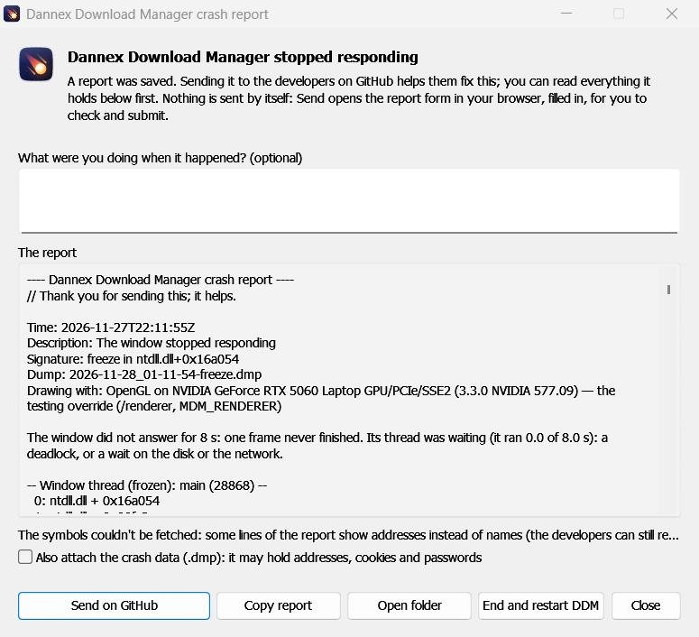

# Crash reports

[← Back to docs index](README.md)

If Dannex Download Manager closes unexpectedly or stops responding, a **crash report** window opens. It shows what happened, lets you read the whole report, and can send it to the developers on GitHub. Each report helps fix the problem for everyone.



## What you see

- **Dannex Download Manager closed unexpectedly**: DDM crashed, or hit an internal error and closed.
- **Dannex Download Manager stopped responding**: its window didn't answer for 8 seconds. DDM is still running, frozen. **End and restart DDM** closes the frozen copy and starts a new one. If DDM answers again by itself, the window says so.

In the window:

1. **What were you doing when it happened?** is optional. A few words, such as "I opened Add URL", help a lot.
2. **The report** shows everything that would be sent. Read it first if you like.
3. **Send on GitHub** opens GitHub's **Crash report** form in your browser, already filled in, along with the folder that holds the report. Drag the report's file into the form, check it, and submit. You need a GitHub account. **Nothing is sent by itself.**
4. If someone already reported the same problem, the window says so (**Already reported as issue #…**). **Open the reported issue** opens it and puts your report on the clipboard, so you can add it as a comment.

The other buttons copy the report, open its folder, or start DDM again.

## What a report contains

- **What happened:** the error and the place in DDM's code where it happened.
- **The stack:** the place in DDM's code where it crashed or froze, and what every other part of it was doing.
- **DDM's recent log:** for example "command AddUrl" or "window opened: add-url".
- **The system:** DDM's version and how you installed it, your operating system and its version, the processor, the language and theme, and how many downloads and queues you have. These are counts only.

It does **not** contain:

- your download addresses or file names;
- your user name, which shows as `~` in folder paths.

If an error message quotes something you typed, that text is in the report, so read it before sending.

**The crash data file (`.dmp`)** is a snapshot of what DDM was running at that moment. It helps the developers most, but it can hold pieces of what DDM had in memory, such as download addresses, cookies and saved passwords. It is only attached when you tick **Also attach the crash data**.

## Where reports are kept

In DDM's data folder:

- `crashes\`: each report (`.txt`) and its crash data (`.dmp`);
- `logs\`: DDM's log (`ddm.log`, with older ones as `ddm.1.log` and so on, 2 MB each).

DDM's data folder is `%APPDATA%\dannexdownloadmanager` on Windows, `~/Library/Application Support/dannexdownloadmanager` on macOS, and `~/.local/share/dannexdownloadmanager` on Linux. In [portable mode](portable.md) it is the `data` folder next to the program.

The log records what DDM does, so a report can show what led to a problem. To log more detail, start DDM with the environment variable `DDM_LOG=debug`.

## For developers

How it works: a second copy of DDM, the **monitor**, starts beside it with `--crash-monitor`. The crash code lives in `crates/crash` and `crates/app/src/crash.rs`.

- **Catching problems.** When DDM crashes (a Windows exception, a signal on Linux, a Mach exception on macOS), panics, or freezes, it asks the monitor for a dump. A freeze is a frame of the window running more than 8 s, seen by a watchdog thread that ignores time spent asleep. It times both parts of a frame: what DDM handles (the commands that come in, the clock of downloads, queues and the Scheduler), which runs minimized too, and the drawing; never the wait between frames. The watchdog also measures how much processor time the window thread got meanwhile, and the report says what that means: it ran all along (a loop), it waited in a lock or on I/O (a deadlock), or it hardly ran in ordinary code, which is a computer too busy to run DDM or slow to load it from disk, most likely not DDM's bug (those share one signature, `freeze while the computer was busy`). When the window thread is already back in the event loop by the time the dump is written, the freeze was over before the snapshot, so its stack can't explain it; those reports say so and share the signature `freeze over before the snapshot`. macOS doesn't measure it yet. The monitor then writes a **minidump** of every thread from outside, through `minidumper` and `crash-handler`. A crashed process never writes its own dump, which is how Firefox, Crashpad and Sentry do it too.
- **Reading the dump.** The monitor reads the dump with Mozilla's `rust-minidump`. It uses the release's Breakpad symbols when they are found. A build from source can also read the native debug info beside it (its `.pdb`, DWARF) when built with `--features mdm-crash/native-symbols`; the shipped app goes without that reader, several MB. The report's **Signature** (for example `freeze in dannexdownloadmanager::winui::combo_edit`) stays the same across reports of one problem, and the window searches existing issues for it.
- **Symbols.** Release builds keep line tables (`debug = "line-tables-only"`), but no download includes the debug info. CI turns it into `DannexDownloadManager-<version>-symbols-<platform>.zip` (`tools/installer/symbols.py`, using Mozilla's `dump_syms`), published beside the release's other files. The report window fetches the zip for its own version when a stack shows bare addresses.
- **A `.dmp` from an issue:**

  ```
  cargo run -p mdm-crash --bin mdm-symbolicate -- crash.dmp DannexDownloadManager-<version>-symbols-windows-x64.zip
  ```

- **Testing it.** `cargo test -p mdm-crash` runs a real freeze, panic and crash (`examples/crashy.rs`) and checks each report's signature. To try it in the app, start DDM with `MDM_CRASH_TEST=1`, then run `dannexdownloadmanager /show crash-test:freeze` (a deadlock; or `spin`, 12 s of a busy window thread, `panic`, `crash`, `abort`). `cargo test -p mdm-app --test freeze_report -- --ignored` does that in a copy of the app off the screens, its window visible and minimized.
