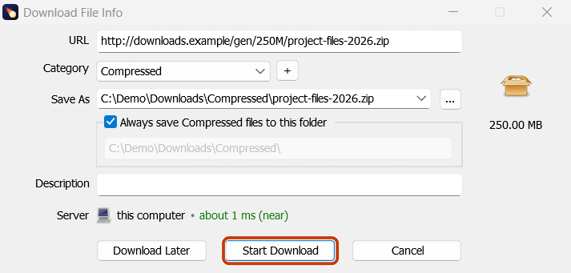
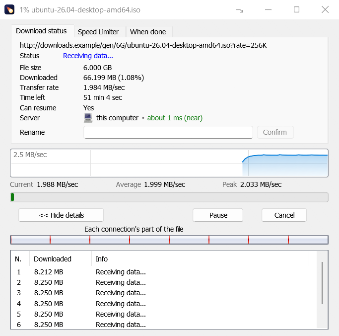
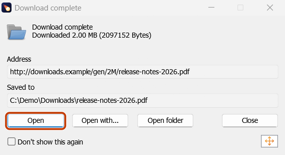
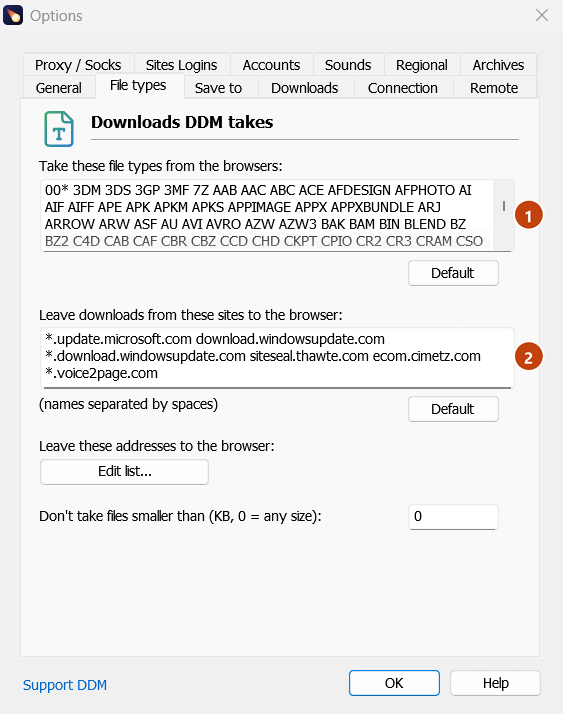

# Tutorial: catch downloads from your browser

[← Back to docs index](README.md)

Set up the extension once, and every download link you click in Firefox, Chrome, Edge, Brave, Opera, Vivaldi or Helium goes to DDM.

## Before you start

On Windows, DDM must be installed with the setup, with **Set up browser integration (Chrome, Edge, Brave, Firefox)** ticked. It is ticked by default. If you're not sure, run the setup again. A portable copy can't do this. On Linux and macOS, start DDM once: it sets browser integration up itself.

DDM's **Add Dannex Download Manager to your browser** window, which opens at each start until a browser's extension has reached DDM, walks you through the steps below. The extension comes with DDM: it is in DDM's folder, so nothing is downloaded from a store.

Once it is set up, a download link goes like this:

<!-- steps -->

1. 
   *Click a download link in the browser: Download File Info opens in DDM.*
2. 
   *Start Download: the progress window shows it coming in.*
3. 
   *Download complete: Open the file, or Open folder.*

## In Chrome, Edge, Brave, Opera, Vivaldi or Helium

1. Open your browser's extensions page: type `chrome://extensions`, `edge://extensions` or `brave://extensions` in the address bar.
2. Turn on **Developer mode**.
3. Click **Load unpacked**.
4. Choose the `extension\chromium` folder inside DDM's folder. If you installed DDM for yourself, that is `%LOCALAPPDATA%\Programs\Dannex Download Manager\extension\chromium`; you can paste that path into the folder box.
5. **Dannex Download Manager** appears. Make sure it is turned on.
6. Go to a web page and click a download link, for example a ZIP or an EXE: DDM opens **Download File Info**. Click **Start Download**.

You don't need to start DDM first: if it isn't running, it starts by itself. Dannex's listing in the Chrome Web Store is on its way; once it is there, the window adds it from the store, which also keeps it up to date.

## In Firefox

Firefox installs only add-ons signed by Mozilla, and Dannex's add-on isn't listed on addons.mozilla.org yet. Until it is:

- **Firefox Developer Edition, Nightly or ESR:** open `about:config`, set `xpinstall.signatures.required` to `false`, then open `about:addons`, click the gear, **Install Add-on From File…**, and choose `extension\ddm-firefox.xpi` in DDM's folder.
- **Any Firefox, until it closes:** open `about:debugging#/runtime/this-firefox`, click **Load Temporary Add-on…** and choose the same `extension\ddm-firefox.xpi`.

Then click a download link, for example a ZIP or an EXE: DDM opens **Download File Info**. Click **Start Download**.

## Choose what DDM takes

- **Which file types:** **Options → File types → Take these file types from the browsers**. Add or remove types, separated by spaces.
- **Sites to leave alone:** **Options → File types → Leave downloads from these sites to the browser**. Add the site's name, for example `downloads.example.com` or `*.example.com`.
- **One browser only:** **Options → General → Take downloads from these browsers**. Untick the ones DDM should leave alone.

*1 the file types DDM takes, 2 the sites it leaves to the browser.*

Everything DDM doesn't take stays with the browser.

## Download a link the browser would open

Links to a PDF or a video file, which the browser would open itself, go to DDM too when their type is listed. To leave one to the browser, hold **Alt** while clicking it (Firefox opens it; Chrome and Edge download it themselves). Any other link: right-click it and choose **Download with DDM**, which takes any type.

## Next steps

- [Browser integration in detail (Firefox, private windows, what is sent) →](browser-integration.md)
- [If the browser doesn't hand downloads over →](troubleshooting.md#the-browser-doesnt-send-downloads-to-ddm)
- [Download overnight →](guide-download-overnight.md)
