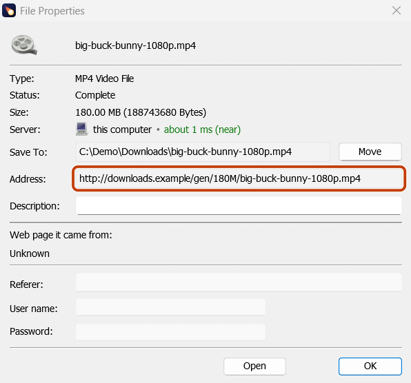

# Tutorial: resume a broken download

[← Back to docs index](README.md)

A download that stopped halfway doesn't have to start over. DDM keeps what it has and continues from there.

## After a cut connection

When the connection drops, DDM retries on its own. In the progress window, the connection table shows **Retrying** and the reason. Usually the download goes on by itself once the connection is back.

When the network stays away longer (the Wi-Fi gone, the server restarting), the download shows **Error** and its log says **The network failed; trying again in 5 s**. DDM starts it again by itself, waiting a little longer each time (5, 10, 20, 40 seconds, then every minute, for about an hour), and it goes on from where it stopped. The same happens after the computer wakes from sleep.

If it gives up and shows **Error**:

1. Select the download in the list.
2. Click **Resume** on the toolbar (or right-click → **Resume Download**).

## After a crash or a restart

DDM saves each download's progress as it goes, so a Windows crash, a power cut or closing DDM loses at most the last moments.

1. Start DDM. The download is in the list under **Unfinished**.
2. Select it and click **Resume**.

## When the link has expired

Many sites hand out links that only work for a while, or only while you are signed in. Resuming then fails, because the old address no longer answers.

1. Right-click the download and choose **Refresh download address**.
2. DDM opens the web page the link came from (when it knows it), and the download's **File Properties**.
3. On the web page, start the download again, or copy the new download link (right-click → **Copy link**). If the browser hands the new download to DDM, cancel it there: you only need the address.
4. Paste the new link into **Address** in **File Properties** and click **OK**.
5. Click **Resume**. The download continues from where it stopped, using the new address.

The new address has to point at the same file. If it doesn't, DDM stops with **the file changed on the server**.

*Paste the new link into Address, then resume.*

## When the file changed on the server

If the site replaced the file with a new version, the parts DDM has don't fit any more. Right-click the download and choose **Redownload** to start again from the beginning. A finished file is only replaced when the new download completes.

## When resuming isn't possible

Look at **Can resume** in the progress window. **No** means the server can't send a file in parts. DDM then uses one connection, and a download that stops has to start over. For such servers, avoid stopping the download, and avoid a very low speed limit, which can make the server drop the connection.

A server that sent parts of the file before but no longer does (it was set up again, or a different server now answers for it) can't continue what DDM has. DDM then downloads the same file again from the beginning, on one connection, and says so in the download's log: **The server no longer sends parts of the file: downloading it again from the start**. If the file itself changed meanwhile, it stops with **the file changed on the server** instead, and never mixes the two.

## When the unfinished file was deleted

If another program deleted or moved the unfinished download's part file (`<name>.ddm.part`), there's nothing left to continue. **Resume** then starts it again from the beginning, and its log says why.

## Next steps

- [Connections and resuming in detail →](connections-and-speed.md#resuming)
- [Troubleshooting →](troubleshooting.md)
- [Back to the docs index →](README.md)
