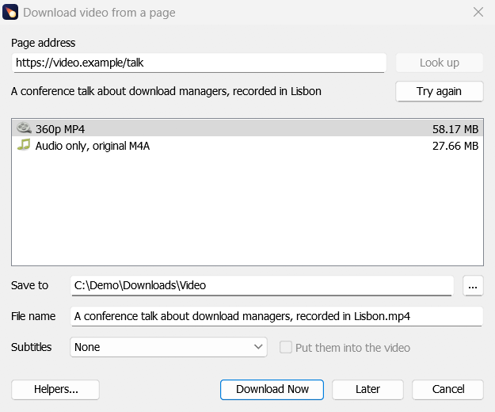
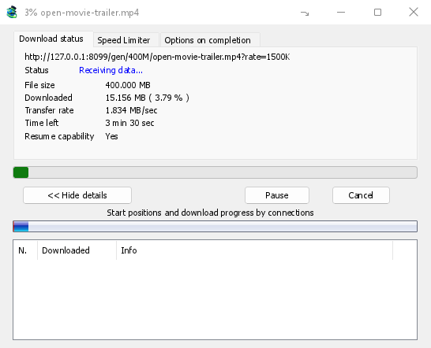

# Tutorial: download a video from a page

[← Back to docs index](README.md)

Save a video from YouTube, Vimeo, TikTok and many other sites, in the quality you choose.

## Steps

1. Open the video in your browser and copy the page's address from the address bar.
2. In DDM, click **Add URL** (or press **Ctrl+N**) and click **OK**. DDM sees that the address is a video's page and opens **Download video from a page**. (You can also open it with **Tasks → Download video from a page...**, paste the address and click **Look up**.)
3. Wait while DDM looks the page up. The list of qualities appears, best first, with **Audio only** at the end: the sound as the site has it, then as an MP3 at its best variable bitrate or at 320, 256, 192 or 128 kbps. (DDM's video tools, yt-dlp and ffmpeg, came with it. If they haven't arrived yet, because the computer was offline, the window says **Getting ready...** and looks the page up as soon as it can. On Linux and macOS DDM uses the system's ffmpeg: without it, you get the qualities that come with their sound, and no MP3.)
4. Pick a quality.
5. Check **Save to** and **File name**. The name comes from the video's title; change it if you like.
6. Want subtitles? Pick a language in **Subtitles**. They're saved beside the video, or inside it if you tick **Put them into the video** (see [Subtitles](video.md#subtitles)).
7. Click **Download Now**, or **Later** to add it to the list without starting.

The video appears in the list and downloads like any other file.

<!-- steps -->

1. 
   *DDM lists the qualities: pick one.*
2. 
   *It downloads like any other file.*

## Good to know

- A link to one video inside a playlist or a mix downloads just that video, not the whole list.
- Videos protected with DRM (most paid streaming services) can't be downloaded.
- Downloading may be against some sites' terms; that is up to you to check.

If the video won't download, see [Video downloads](video.md#if-a-video-wont-download).

## Next steps

- [Video downloads in detail →](video.md)
- [Find a download in a long list →](guide-find-in-long-list.md)
- [Back to the docs index →](README.md)
