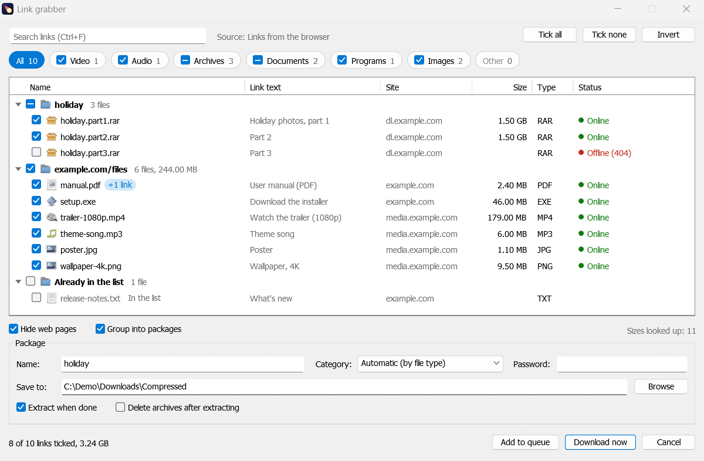

# Link grabber and archives

[← Back to docs index](README.md)

**Link grabber** gathers many links at once, sorts them into packages, and lets you tick the ones to download. DDM can then extract the archives it downloaded (zip, 7z, rar and more), by itself or when you ask.

## Where links come from

- **The browser.** Right-click a page for **Download all links with DDM**, or select part of it for **Download selected links with DDM**. The page's referrer and cookies go with each link, and so does the text the page shows for it (its words, or a picture's description), in the **Link text** column.
- **Tasks → Import → From a text file** and **From an IDM list (.ef2)**. An `.ef2` file brings each download's referrer and cookies.
- Several links, or a `.txt` or `.ef2` list, dropped on the download list.
- **Pasting.** Choose **Tasks → Link grabber...** and press **Ctrl+V**: every web address in the copied text is added.

Links that come while the window is open join the ones already there. A link that is already in the window isn't added twice.

## The list

Each link has a row: its tick box, its file's icon and name, then

- **Link text**: what the page shows for the link;
- **Site**: where the file is (`example.com`);
- **Size**, once DDM has looked the link up (see below);
- **Type**: the file's type (`PDF`, `MP4`);
- **Status**: what looking it up found.

Click a column's title to sort by it; click it again for the other way, and a third time to go back to the order the links came in. Names sort as people read them (`part2` before `part10`).

Some rows carry a mark after the name, and come unticked:

- **In the list**: the download list has this link already.
- **On disk**: the file is already in the folder it would go to. Tick it anyway and DDM saves it under a numbered name, `report (1).pdf`.
- **+2 links**: two more links on the page lead to the same file (the same name, and the same size once known), such as a mirror. They are grouped under this one: click the mark, or press **Right**, to see them. Each says **Same file** and stays unticked, so the file is downloaded once.

## Finding and ticking links

- **Search links** (**Ctrl+F**) shows the links whose name, text or address contain what you type. **Esc** empties it.
- The buttons under it show one kind of file: **Video**, **Audio**, **Archives**, **Documents**, **Programs**, **Images** or **Other**, each with how many there are (**All** shows them all). **Alt+1** to **Alt+8** do the same from the keyboard.
- The box on each of those buttons ticks every link of that kind (the search's, if you typed one), or unticks them when they all are. Half-filled, some are ticked.
- **Tick all** (**Ctrl+A**), **Tick none** (**Ctrl+Shift+A**) and **Invert** (**Ctrl+I**) act on the links shown.
- **Space** ticks or unticks the selected row, **Delete** takes it out of the window, **Ctrl+C** copies its address, and typing a name's first letters goes to it.

**Hide web pages** (on by default) leaves out links to pages (`.html`, `.php` and the like): they are neither shown nor downloaded.

## Packages

With **Group into packages** ticked (the default), the links are in packages. Each package is a row you can open and close (click its arrow, double-click it, or press **Right** and **Left**). Ticking a package ticks all its links shown; its box is half-filled when only some are ticked.

- **The volumes of one archive** (`movie.part1.rar`, `movie.part2.rar`…, or `backup.7z.001`, `backup.7z.002`…) form one package named after the archive, as long as they come from the same site.
- **The other links of one page** form a package named after the page.
- **Everything else** goes into **Various files**.
- Links the download list has already go into **Already in the list**.

Untick **Group into packages** for one list of every link, sorted as a whole.

## Looking links up

As links arrive, DDM asks each server about its file, as IDM's **Download all links** does: sixteen links at a time, and at most six from any one site, so a page of thousands is looked up quickly without flooding a server. **Looking up sizes: 120 of 340** under the list shows how far it has got. Each link then shows its real name and size, and a status:

- **Online**: the server has the file.
- **Offline (404)**: it doesn't. The link is unticked.
- **Needs a login**: the server wants a user name and password, or the page's cookies.
- **Busy, try later**: the server asked to wait.

Turn the look-ups off in **Options → Archives → Look links up when they arrive**. Some file hosts count a look-up as a download.

## The package box

The box under the list edits the package of the selected row:

- **Name**: the package's name, kept with its downloads.
- **Category**: **Automatic (by file type)** puts each file in its own category, as Import always did; choose one, and all the package's downloads go in it, to its folder.
- **Save to**: the folder its files go to. When a package holds several kinds of files and no category is chosen, the box says **Each file's category folder**: each file goes to its category's folder (**Options → Save to**).
- **Password**: the archives' password, if they have one. It is kept in memory only, never written to disk.
- **Extract when done**: ticked by itself when the package holds an archive.
- **Delete archives after extracting**: once extracted, the archives go to the Recycle Bin (the Trash on macOS and Linux).

## Adding the links

The line at the bottom says what would be added: how many links are ticked, of how many, and their size together (and how many have no size known yet).

- **Download now** (**Enter**) adds the ticked links to the **Main download queue** and starts the queue. It downloads as many files at once as the queue allows.
- **Add to queue** adds them to the **Main download queue** without starting them, as IDM's import does.
- **Cancel** (**Esc**) closes the window and adds nothing.

Each download keeps its link text as its **Description**. The links come as one batch: no Download complete window opens as each of them finishes (with **Notify when downloads complete** on, one small notification says they are done; see [The tray icon](getting-started.md#the-tray-icon)).

## Extracting archives

DDM itself extracts zip archives (AES-encrypted and Deflate64 ones too), tar, tar.gz and tar.xz archives, and single `.gz` and `.xz` files.

**7z and RAR archives need 7-Zip**, a free program ([7-zip.org](https://www.7-zip.org/)). DDM runs it when it is installed, for split and encrypted archives too. RAR's own extraction code can't be part of a free program like DDM, and 7-Zip extracts 7z best.

**Options → Archives** says whether 7-Zip was found. Without it, a 7z or RAR archive isn't extracted, and the **7-Zip needed** window says so, with a **Get 7-Zip** button.

An archive is extracted:

- when its package says **Extract when done**,
- when **Options → Archives → Extract archives when their download completes** is on (off by default), for any other download,
- when you right-click a finished archive and choose **Extract**.

A split archive is extracted once, when its last volume is downloaded. The files go next to the archive:

- into a folder named after the archive when it holds several things at its top (or always, or never: **Options → Archives**),
- a file that is already there is kept, and the new one is numbered: `report (1).txt`.

Extracted files are marked as coming from the internet, as the archive is, so Windows still warns before running a program from it.

DDM extracts safely. A name that would lead outside the folder is left out, and so is a link to somewhere else on the disk. An archive that would write far more than its size, or more than the disk has room for, stops before it fills it. When something goes wrong, nothing but the archive is left behind.

The download's log (hover over it in the list) says what happened: **Extracted 12 files to …**, or why not, for example **Couldn't extract movie.7z.001: volume 3 of it is missing**. An encrypted archive without its password opens the **Archive password** window. Type the password and click **Extract**, or **Cancel** to leave the archive as it is.

## Next steps

- [Adding downloads →](adding-downloads.md)
- [Options → Archives →](options.md#archives)
- [Browser integration →](browser-integration.md)
