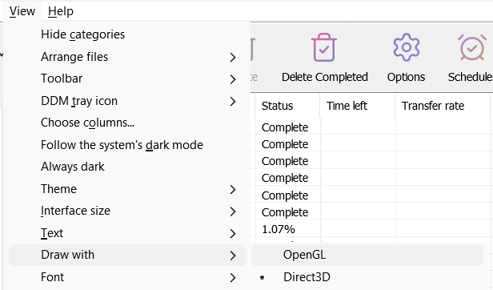
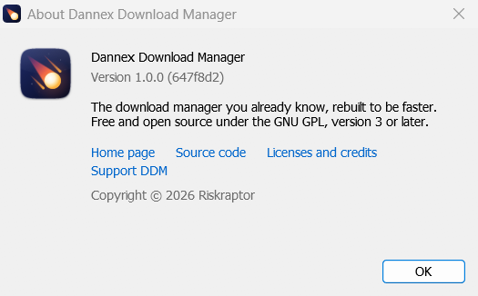

# Troubleshooting

[← Back to docs index](README.md)

## First, look at what happened

Every download keeps a log of its recent events: retries, redirects, the server's answers and errors.

- Hover over the download's **Status** in the list to see them.
- Or open its progress window (double-click an unfinished download). The connection table shows what each connection is doing, and **Retrying** with the reason when one fails.
- **File Properties** (**Alt+Enter**) shows **Last try** and its **Result**.

## A download says Error

1. Read the reason (hover over **Status**).
2. Select the download and click **Resume**. Many errors are a server or connection having a bad moment.
3. If the link has expired (common for links from sites you sign in to, or links with a time limit in them), get a new one: right-click → **Refresh download address**. See [Resume a broken download](guide-resume-broken-download.md).
4. If it says **the file changed on the server**, the file isn't the one DDM started with. Right-click → **Redownload** to start again from the beginning.
5. If it says **Google Drive won't give this file now**, Drive's download limit for that file was reached. See [Google Drive links](adding-downloads.md#google-drive-links).
6. If it says **this site lets only browsers through**, the site's bot check (Cloudflare's, for one) turned DDM away. DDM has already asked once more connecting the way your browser does, with your browser's cookies for that site, and the site still wants its check answered in a browser. Click **Download with the browser** in the download's progress window, or right-click the download and choose **Download with the browser**: its address opens in the browser it came from (or your default browser), where you can answer the check, and the browser keeps that download. The row stays in DDM's list; **Resume** tries again there. See [Browser integration](browser-integration.md#a-site-that-lets-only-browsers-through).
   Where DDM offers no such button (a link it looked at before adding it), hold **Alt** as you click the link to leave that download to the browser.

## A download starts over instead of resuming

- Look at **Can resume** in the progress window. **No** means the server can't send a file in parts, so DDM can't continue it later.
- Some servers report a new date for the same file every time. Tick **Options → Downloads → Resume even if the file's date on the server changed**.

## Downloads are slow

- Check that the Speed Limiter is off: **Downloads → Speed Limiter → Turn off**. Also look at **Downloads → Speed Limiter → Settings... → Limit all downloads together to**, which applies even with the limiter off.
- Check the download's own **Speed Limiter** tab in its progress window.
- Check **Options → Connection**. A low **Each download uses up to**, or an exception for the server, means fewer connections. Rows marked **(auto)** are servers that refused more connections; DDM can't do more there.
- Check **Download limits** in the Scheduler. When the limit is reached, downloads wait with **Waiting: the download limit is reached (Scheduler)**.

## The browser doesn't send downloads to DDM

1. Was DDM installed with the setup, with **Set up browser integration** ticked? A portable copy can't take browser downloads. Run the setup again to add it.
2. Is the extension loaded and turned on? Look for **Dannex Download Manager** on the browser's extensions page. In Firefox, a temporary add-on is gone after a restart: [Browser integration](browser-integration.md#firefox) says how to keep it. See [Browser integration](browser-integration.md).
3. Is **Options → General → Take downloads from web browsers** on, and your browser ticked under **Take downloads from these browsers**?
4. Is the file's type in **Options → File types**? Only listed types are taken automatically. **Download with DDM** on the right-click menu takes any link.
5. Is the site in **Leave downloads from these sites to the browser**?

When none of this helps, the browser keeps the download, so nothing is lost. The extension's toolbar button turns grey with a red **!**, and a click on it opens its status page, which says why it couldn't reach DDM and what to do; see [The browser and DDM aren't connected](browser-help.md).

## The Scheduler didn't start the queue

- DDM must be running at that time. Closing the window is fine (it stays in the tray); **Tasks → Exit** is not.
- Did you click **Apply** after setting the time?
- **Repeat on** starts only on the ticked days. **Once on** starts only on that date.
- A computer that is asleep doesn't run anything until it wakes, unless the queue has **Wake the computer to run this queue** ticked (on Windows it needs **Allow wake timers** in the power plan; the Scheduler says when it's off). See [Wake the computer to run a queue](queues-and-scheduler.md#wake-the-computer-to-run-a-queue).

## A video won't download

See [If a video won't download](video.md#if-a-video-wont-download).

## A magnet link takes a long time

A magnet link has to get the torrent's file list from other peers first. That can take a minute or two, and longer for torrents with few peers. If nobody answers in about three minutes, DDM gives up; try again later, or use the `.torrent` file if the site offers one.

## DDM uses a lot of memory

Task Manager shows several figures, and they mean different things:

- **Memory** (on the Processes tab) is what DDM holds for itself alone, its *private working set*. With the window open and nothing downloading, that is about 70 MB.
- **Working set** (Details tab, add the column) adds memory shared with other programs. DDM draws its windows with the graphics card, so the graphics driver's memory counts here too, about 120 MB in all.
- **Commit size** is memory DDM has reserved, whether in use or not.

Closed to the notification area, DDM gives its memory back to Windows: **Memory** drops to under 10 MB within seconds and stays low while it waits. Downloads, queues and the scheduler go on as before. The list of every language (**View → Language**) loads fonts for every script while it's open; DDM lets them go when it closes.

## The text is too small or blurry

DDM keeps Internet Download Manager's compact sizes. On a large or high-resolution screen, choose **View → Interface size** (110 %, 115 %, 120 %, 125 %, 150 %, 175 % or 200 %), or press **Ctrl +** and **Ctrl −** in any DDM window, as in a browser; **Ctrl 0** goes back to 100 %. Every window follows at once, and DDM starts at that size next time. It comes on top of Windows' own display scale (**Settings → System → Display → Scale**).

A window larger than the screen at that size (Options at 200 % on a 1366 × 768 screen) opens as large as the screen allows, and the rest scrolls: with the scroll bars, the mouse wheel, or **Tab** to the next control.

DDM tells Windows it draws for each monitor's own scale, so Windows never stretches its windows into blur, and it draws Windows' fonts grid-fitted to whole pixels. If the text still looks blurred, tell us your screen's resolution and Windows' display scale when you [report it](https://github.com/Riskraptor/dannexdownloadmanager/issues).

## The window freezes or draws wrongly

On Windows, DDM draws its windows with Direct3D 12; on Linux and macOS, with OpenGL, or with Vulkan (Linux) or Metal (macOS) when you choose them. A graphics driver can still misbehave: a window that holds still for seconds, flickers, or shows wrong colours or blocks. Try the other one: choose **View → Draw with → OpenGL** (or **Direct3D**, **Vulkan**, **Metal**), then quit DDM (**Tasks → Exit**) and start it again. Choosing the first one goes back the same way.

*View → Draw with: the other way of drawing.*

- If Direct3D, Vulkan or Metal can't start on your computer (no driver for it, some virtual machines), or its first window doesn't show within 10 seconds of its own (the time DDM spends loading your list and its icons doesn't count, however slow the computer is just after it starts), DDM draws with OpenGL, and **View → Draw with** says so and why. Choosing it again tries it again at the next start.
- On Linux, Vulkan needs your graphics card's Vulkan driver: Mesa's (`mesa-vulkan-drivers` on Ubuntu and Debian, `vulkan-radeon` or `vulkan-intel` on Arch) for AMD and Intel, NVIDIA's own driver for NVIDIA.
- If neither can start, DDM draws with a software renderer (Microsoft's on Windows, Mesa's on Linux), so the window still opens (Remote Desktop, a virtual machine without a graphics driver). It works, but keeps the processor busier.
- If the graphics card is reset while DDM runs (a driver update), DDM starts again by itself. Lost twice in 10 minutes, it goes back to OpenGL, and **View → Draw with** says why.
- Updating the graphics driver from the card maker's site (Intel, AMD or NVIDIA) fixes many of these problems.
- A freeze whose report shows the window thread inside the graphics driver as it shows a frame (`ig4icd64.dll` or `ig9icd64.dll` for Intel, `nvoglv64.dll` for NVIDIA, `atio6axx.dll` for AMD, under `opengl32.dll`) is the driver's OpenGL stuck, not DDM: on Windows, choose **View → Draw with → Direct3D** (the default) and restart DDM, and update the graphics driver. If **Draw with** says Direct3D didn't start there, the line under it says why.
- A freeze or crash report says which one was drawing, on which graphics card and driver, and why that one (chosen, the default, or the other one failing), on its `Drawing with:` line near the top: include it when you report a problem. A freeze report also says whether DDM was busy, waiting, or hardly ran at all (a computer too busy to run it); see [Crash reports](crash-reports.md).

## The setup or DDM won't start

- If Windows says **Windows protected your PC**, click **More info**, check that the file is `DannexDownloadManager-<version>-setup.exe` from the [Releases](https://github.com/Riskraptor/dannexdownloadmanager/releases) page, then click **Run anyway**.
- DDM runs only once. Starting it again brings the running copy's window to the front. If nothing appears, look for DDM's icon in the notification area.
- **Linux, from the AppImage or the tar.gz:** if the system lacks a library DDM's window needs (such as `libxkbcommon-x11`), DDM names it on the terminal and in a message box, with the command that installs it (`sudo apt install libxkbcommon-x11-0`, or your distribution's). The .deb and .rpm bring these libraries themselves. In a Wayland session DDM opens its window on Wayland instead.
- **Linux, the first start is slow:** DDM looks up the system's fonts for every script once, all together, while it starts (fontconfig); a first start on a busy computer can take a few seconds more. Install your distribution's Noto fonts if some scripts or symbols show as boxes.

## My antivirus or VirusTotal flags DDM {#antivirus}

A few antivirus programs flag new installers just because they have rarely seen them, and machine-learning engines do this the most. On VirusTotal, a handful of small engines flagging a new setup while the big ones stay clean is usually a false positive. We report these to the vendors when we see them.

To check that your copy is the real one:

1. Download DDM only from [GitHub Releases](https://github.com/Riskraptor/dannexdownloadmanager/releases), where every release is built from the public source by GitHub Actions, or from [Dannex's website](https://dannex.kavangi.co.ke/download.html), whose download buttons lead there. A download from any other site isn't Dannex's.
2. Get your file's SHA-256. On Windows, run `certutil -hashfile "DannexDownloadManager-1.0.0-setup.exe" SHA256`; on Linux, `sha256sum` and the file's name.
3. Compare it with the same file's line in that release's `SHA256SUMS.txt`.

If they match, it is the file we published. Every release is built on GitHub from the [public source code](https://github.com/Riskraptor/dannexdownloadmanager), so anyone can read what went into it.

If your antivirus quarantined DDM, restore it and add an exception for its folder. If it flags something other than the setup or DDM's own programs, or a copy from anywhere else, don't run it, and please [tell us](https://github.com/Riskraptor/dannexdownloadmanager/issues).

## HTTPS downloads fail with "no certificates" (Linux)

A minimal Linux system (often with the AppImage, the tar.gz or a build from source) may have no CA certificates, which DDM needs to check a secure server. Plain `http://` and `ftp://` downloads still work; each `https://` or `ftps://` one stops at once saying the computer has no certificates to check the server with. Install the `ca-certificates` package (`sudo apt install ca-certificates`, `sudo dnf install ca-certificates`), then resume the download. The .deb and .rpm bring it.

## Where your data is

- Installed or the plain zip: `%APPDATA%\dannexdownloadmanager`. The list and settings are in `downloads.json`.
- Portable: the `data` folder next to `dannexdownloadmanager.exe`.
- Linux: `~/.local/share/dannexdownloadmanager`; a Mac: `~/Library/Application Support/dannexdownloadmanager`.
- Passwords (Sites Logins, the proxy, debrid accounts) are in the system's keychain, not in `downloads.json`; see [Options → Sites Logins](options.md#sites-logins).

To back up your list, quit DDM (**Tasks → Exit**) and copy `downloads.json`.

## Updates

**Help → Check for updates...** tells you whether a newer version is out, and what is new in it. **Check for updates at every start** in that window lets DDM look by itself: a few seconds after it starts, and once a day while it stays open. When there's a new version, its window opens in front.

When there is one, **Update now** downloads it, checks it, puts it in place and restarts DDM; your list, settings and downloads stay as they are:

| You installed | What Update now does |
|---|---|
| Windows, the setup | Runs the new setup without its windows. An installation for all users asks for the administrator's permission. |
| Windows, the portable or plain zip | Replaces the programs in their folder (a portable copy's `data` folder is kept). |
| Mac | Replaces the app in Applications. |
| Linux, the AppImage or the .tar.gz | Replaces the AppImage, or the programs in their folder. |
| Linux, the .deb or .rpm | Opens the checked package in your system's package installer, which asks for your password. |
| Linux, another package manager's package (pacman, ...) | Nothing: the window says so, and your system's updates bring the new version. |

DDM installs an update only when the release's list of checksums is signed by DDM's release key and the file matches it; anything else is refused, and **Download** opens the [Releases](https://github.com/Riskraptor/dannexdownloadmanager/releases) page instead.

The AppImage can also be updated by AppImage tools (AppImageLauncher, Gear Lever, AppImageUpdate): it carries the address of its updates, and each release has its `.AppImage.zsync` file, so those tools download only the parts that changed. This starts with the AppImage of the version after 0.2.4.

**Help → About DDM** shows the version you have.

*Help → About: the version you have.*

## Reporting a problem

Choose **Help → Report a problem**. It opens the bug report form on GitHub with your DDM version, your system and its version, how DDM was installed and its interface language already filled in. Describe what happened, what you expected and the steps that make it happen. For a download, include the address if you can share it, and the reason shown under **Status**.

You can also [open the form yourself](https://github.com/Riskraptor/dannexdownloadmanager/issues/new?template=bug.yml); it asks for the same details.

## Next steps

- [Resume a broken download →](guide-resume-broken-download.md)
- [Browser integration →](browser-integration.md)
- [Back to the docs index →](README.md)
