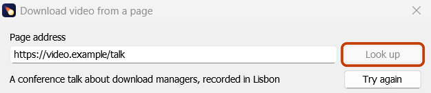
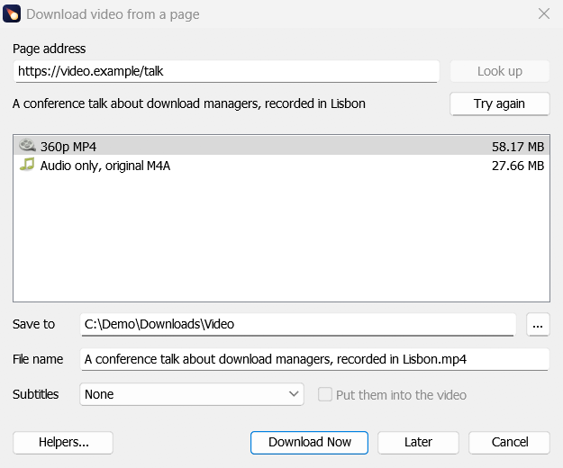
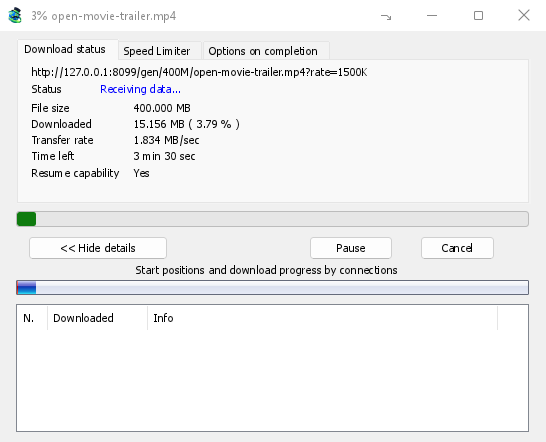
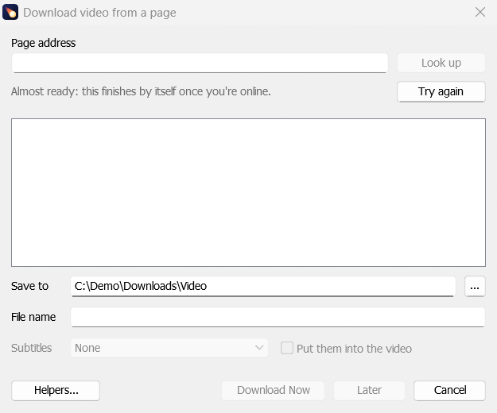
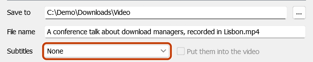
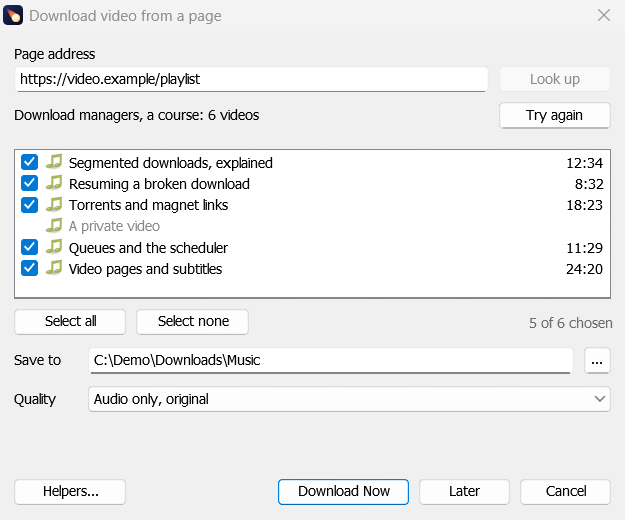
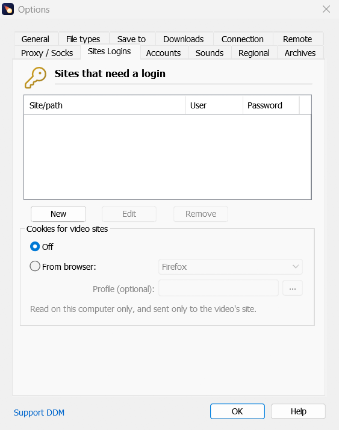

# Video downloads

[← Back to docs index](README.md)

DDM downloads videos from their web pages: YouTube, Vimeo, Dailymotion, Twitch, TikTok, X, Instagram, Facebook, Reddit, SoundCloud and well over a thousand other sites. **yt-dlp**, an open-source program whose community keeps it working as sites change, finds the video on the page; DDM's own downloader then brings it in, the way it downloads any file.

## Start a video download

- Give the video's page address to **Add URL** (**Ctrl+N**). DDM recognises video pages and opens the video window, already looking the page up.
- Or choose **Tasks → Download video from a page...**, paste the address into **Page address** and click **Look up**.

Any other page address that turns out to be a web page, not a file, is offered to the video window too.

<!-- steps -->

1. 
   *Paste the page's address and click Look up.*
2. 
   *Pick a quality, then Download Now.*
3. 
   *It downloads like any other file, in its own row and window.*

## yt-dlp and ffmpeg

DDM's two video tools come with it: nothing to click. The Windows setup gets them while it
installs (under **Finishing installation...**, with a progress bar). A portable copy, and DDM on
Linux and macOS, get them by themselves the first time DDM starts. DDM downloads them from their
official releases with its own downloader, so a cut connection resumes, and uses your proxy
settings:

- **yt-dlp** (about 24 MB) looks the page up and finds where the video and its sound come from; DDM downloads them ([How a video comes down](#how-a-video-comes-down)). DDM checks the download against the signature yt-dlp's developers publish before it uses it. On Windows and macOS DDM takes yt-dlp's folder build and unpacks it once, so yt-dlp starts in about half the time at each look-up and download (the single-program build unpacks itself every time it starts). A copy installed by an earlier DDM keeps working, and the next update of yt-dlp replaces it with the folder build.
- **ffmpeg** (about 80 MB) joins a video and its sound when a site keeps them apart, which most sites do for the higher qualities, and turns the sound into an MP3, Opus or FLAC file. DDM checks it against the checksums its release publishes. On Linux and macOS DDM uses the system's ffmpeg: install it with your package manager (or Homebrew).

Both are kept in a `tools` folder in DDM's data folder.

**Offline when you install?** The setup finishes anyway, saying **Some parts will finish
setting up the next time you're online**. DDM then gets the tools itself once it is online:
right away when the network comes back, and again a little later if a download fails, without
asking. The status strip under the list says **Getting ready...** while they come. A video you
ask for meanwhile waits (its status says **Waiting**) and starts by itself as soon as yt-dlp is
there. **Download video from a page** says **Getting ready...** too, and looks the page up once
it can; **Try again** beside **Almost ready: this finishes by itself once you're online** tries
at once. **Helpers...** shows which copy of each tool DDM uses.

### Use your own copies

On Linux and macOS, DDM finds yt-dlp, ffmpeg and gallery-dl on your `PATH` and in the usual package-manager folders, including Homebrew's. A program you selected yourself takes priority, followed by DDM's own installed copy. The system copy is used when neither is present, and your package manager keeps it up to date: DDM never downloads over it on its own. If your distribution's yt-dlp is old, **Use DDM's own copy** in Helpers downloads DDM's, which keeps itself current and is used from then on.

Already have yt-dlp or ffmpeg for another program? Use those instead of a second copy: in **Download video from a page**, click **Helpers...**, then **Use another program...** beside yt-dlp or ffmpeg, and choose the program. DDM runs it once to check that it is that program, and uses it from then on, the command line too. DDM doesn't update a program you chose: keep it up to date yourself (yt-dlp: `yt-dlp -U`, or your package manager). **Use DDM's own copy** goes back to the one DDM downloads and checks.

*Helpers...: use your own yt-dlp or ffmpeg instead.*

## Choose the quality

1. Wait for the list. It shows each resolution with its size, best first, then the sound alone:
   - **Audio only, original**: the site's own file, not converted (M4A, or WebM with Opus inside, as the site serves it). The best sound there is, in the smallest file.
   - **Audio only MP3** at its best variable bitrate (VBR) and at 320, 256, 192 and 128 kbps, for players that only take MP3.
   - **Audio only OPUS**: an `.opus` file. When the site's sound is Opus already (YouTube's usually is), it's only moved into that file, not converted, so nothing is lost.
   - **Audio only FLAC**: a lossless `.flac` file, for a library or a program that wants FLAC. It can't add quality: the site's sound is already compressed with losses, and FLAC keeps it exactly as it came, in a file several times bigger. The window says so when you choose it.
2. Pick one. Without ffmpeg, only the qualities that come with their sound are listed, and no MP3, Opus or FLAC (ffmpeg makes them).
3. Check **Save to** (the Video category's folder by default) and **File name**, which comes from the video's title.
4. Choose **Subtitles** if you want them (see below).
5. Click **Download Now**, or **Later** to add it to the list without starting.

The video then downloads like any other file, with its own row in the list and its progress window.

### From the Download video button in your browser

The browser extension's **Download video** button over a video opens the same qualities in a menu over the page ([Browser integration](browser-integration.md)). yt-dlp takes a few seconds to look a video up, so the menu doesn't wait for it when the page already says what it holds:

- **At once from the page.** On YouTube the player itself lists the video's formats, and on other sites the HLS or DASH stream the player loaded lists its qualities. The menu shows them straight away, the way DDM will list them: each resolution with its size, then the sound. A thin line moving along the menu's top edge means DDM is still checking. When DDM's own look-up comes, its list takes the place of the page's, row for row: sizes are corrected and any quality the page didn't name is added, while the row under the pointer stays where it is. The page's sizes are written as estimates (**~128.4 MB**) until then; DDM's are those of the very formats it will download (on YouTube, its AV1 or VP9 picture and its Opus sound, not the largest file of each height), with **~** only where the site gives no exact size (a stream sized from its bitrate, a conversion to MP3, Opus or FLAC). If the page says nothing DDM can use (a live stream, a protected video, a site that names no qualities), the menu says **Looking up the qualities...** and shows DDM's list when it comes, as before.
- **The file the page played, first.** When the video's player loaded the video's own file (TikTok's player does, and so does any page playing an MP4 or WebM), the menu lists that file first, as soon as it opens, worded like any other quality (its picture's height, its type and size: *1024p MP4*). Pick it and DDM downloads that very file, as it downloads a link: **Download File Info** opens, then DDM's own downloader brings it in over several connections. It goes with your browser's cookies for the file's server, the page as the referrer and your browser's User-Agent, as the player fetched it, and nothing is looked up, so it works even when the site turns yt-dlp away (TikTok does, to an address that asked it often). It is named after the video's title once DDM's look-up has found it, else after the page. A file the player was fed in pieces is offered only once its first bytes show that it is that player's video: the same length and picture size. In a feed, where two videos of the same length may play side by side, neither is offered then, and the menu waits for DDM's look-up as before.
- **In a feed too.** A video in a feed (a timeline, a profile, a home page) whose player loaded its own stream goes with that stream, without opening its post: on X, the stream whose address carries the id its picture carries, else the one stream exactly as long as the video. Its qualities show at once, and DDM reads that stream, never the site's own pages.
- **A sound with no video.** On a music site, a podcast or a radio's page, the button stands on the page's player bar as **Download audio** ([Music, podcasts and radio](browser-integration.md#music-podcasts-and-radio)); its menu opens on the **Audio** tab, and so does a YouTube Music song's: the sound as the site has it, MP3 and the other conversions.
- **Copy-protected.** Over media a page decrypts (DRM), the button says **Protected** and its click says that it can't be saved: nothing is looked up.
- **Picked before DDM is done.** A quality picked from the page's list stays marked until DDM's list comes, then downloads by itself. If DDM doesn't offer that quality after all, the menu says so and shows what it does offer.
- **Ready before you click.** When the pointer reaches the button, or rests for a moment over the video on that video's own page (a YouTube watch page, for example, never a feed or YouTube Shorts), DDM starts looking the video up already, so its list is often ready when the menu opens. One look-up at a time. It starts only while DDM isn't looking up another video, and stops when you leave the page. In a private window nothing is looked up before you click.

Whichever list you pick from, DDM downloads the quality from its own look-up of the video, with yt-dlp, exactly as from the **Download video from a page** window. The file the page played is the exception: it is downloaded as it is, without yt-dlp.

## How a video comes down

yt-dlp looks the page up and picks the quality's video and sound. DDM's own downloader then brings each of them in, one after the other, the way it downloads any file:

- **Over several connections**: as many as **Options → Connection** gives a file. The progress window's connections table shows each one, and the segment map shows the video and then its sound.
- **A stream sent in many small pieces** (HLS, DASH, as most sites other than YouTube send theirs) comes down that many pieces at once, each kept on disk as it arrives, then joined in order into one file, as yt-dlp joins them. Pieces encrypted with AES-128 are decrypted with the key the stream's playlist names. When their addresses expire, DDM asks yt-dlp for the stream's new list and carries on with the pieces still missing.
- **Under your speed limits**: the **Speed Limiter**'s, the video's own (its progress window's **Speed Limiter** tab), and the limit for all downloads together. A change applies at once.
- **Paused and resumed** like a file, also after quitting DDM: it carries on from the bytes already saved.
- **When an address stops working**: a video's addresses are signed and expire after a few hours (YouTube's after six). DDM asks yt-dlp for a fresh one for the same quality and carries on from where it stopped.

Then yt-dlp does what it does after a download: it joins the video and its sound with ffmpeg into one MP4, saves or embeds the subtitles, and converts the sound for an MP3, Opus or FLAC choice.

YouTube serves each connection's long requests slowly, so DDM asks for the video in pieces of 10 MB at most, as yt-dlp does, and several at once.

Some videos yt-dlp still downloads by itself, over its own connection, and the progress window says so:

- a live stream still being recorded;
- a stream sent over RTMP, RTSP, MMS or FTP;
- the rare streams in pieces of other kinds (Adobe's HDS, Microsoft's Smooth Streaming), and one whose key the site hands yt-dlp directly.

For those, a new speed limit starts the download again with it, from where it was ([Speed limits](#speed-limits)).

## Subtitles

When the video has subtitles, the **Subtitles** list offers them: the uploader's own languages first (and **All the uploader's** when there are several), then the site's automatic captions, marked *automatic*. Of those, only the ones in the language spoken and their translations into English and your interface language are listed (marked *automatic translation*); sites like YouTube offer a machine translation into every language they know.

*Choose the subtitles; tick Put them into the video to keep them inside the file.*

- Saved beside the video, they get its name and the language: `My video.fr.srt`. Players such as VLC and MPV pick them up on their own. With ffmpeg they're always SRT; without it, the site's own format (often WebVTT, `.vtt`).
- **Put them into the video** puts them inside the file instead, as tracks you switch on in the player. It needs ffmpeg, and an MP4 or MKV video.
- A sound-only choice (**Audio only**, MP3, Opus, FLAC) has no subtitles.

DDM offers the same choice again for the next video when it has that language.

YouTube refuses its automatic translations to download programs: an *automatic translation* comes with the captions it's made from, and when YouTube refuses the translation, those are saved instead (beside the video or inside it, as you chose), and the **Download complete** window says so.

A site may also refuse subtitles when it's asked too often. The video is saved all the same. DDM asks for the subtitles once more after 20 seconds, and if they still don't come, the **Download complete** window and the download's log say which ones are missing and why. Try them again later. When subtitles meant to go inside the video only come on that second try, they're saved beside it instead.

## Playlists and channels

Paste the address of a playlist (`youtube.com/playlist?list=…`) or a channel's videos (`youtube.com/@name/videos`) and click **Look up**. Instead of one video's qualities, the window lists the list's videos, each with its length.

*A playlist: every video ticked, one quality for all.*

- A playlist is listed whole, as its videos come in: the line above the list says how far it is ("Listing the videos: 1,200 of 6,000"). **Stop listing** keeps the ones listed so far, and **List the rest** carries on from there. If the site stops answering part-way (YouTube may, when it's asked too often), the window says after how many videos and why, and **List the rest** tries again from there.
- A channel is listed 50 videos at a time, newest first. **Load more** lists the next 50.
- Every video starts ticked. Untick the ones you don't want, or use **Select all** and **Select none**. Private and deleted videos are greyed out and can't be ticked.
- **Quality** applies to every video: **Best quality**, **Up to** a height (each video at that height, or the nearest below it), **Audio only, original**, **Audio only MP3**, **Audio only OPUS** or **Audio only FLAC**. Without ffmpeg, only the qualities that come with their sound are offered, and no MP3, Opus or FLAC.
- The videos go into a folder named after the list, inside **Save to**, each under its own title.

**Download Now** adds each video as its own download and starts the main queue, which runs as many at once as you set in the [Scheduler](queues-and-scheduler.md) (**Run N downloads at once**). **Later** adds them without starting. Adding more than 500 at once asks first.

DDM lists at most 20,000 videos of one list.

A page address that points at one video inside a playlist or a mix (for example `watch?v=…&list=…`) downloads that one video, never the whole list.

## Speed limits

Videos keep to the [Speed Limiter](connections-and-speed.md#speed-limiter): the limit for one file, a video's own limit (the **Speed Limiter** tab of its progress window), and the limit for all downloads together, which they share with every other download. DDM's own downloader brings them in, so a change applies at once, as for a file.

A video yt-dlp downloads by itself ([How a video comes down](#how-a-video-comes-down)) takes a limit only as it starts: when you turn the limiter on or off, change its settings or the video's own limit, DDM stops it and starts it again with the new limit, and it goes on from where it was (the log says "Stopped: the speed limit changed; starting again with it"). Under the limit for all downloads, such videos share it evenly: when another starts, the ones running with more than their share start again with it; when one ends, the others keep theirs. An image gallery's files that gallery-dl downloads itself ([Image galleries](galleries.md#how-a-gallery-comes-down)) do the same, gallery-dl skipping the files already saved; those DDM downloads keep to a new limit at once. Other changes (torrents taking more or less of the limit for all downloads, **Only while I'm using the computer**) apply to the next one that starts.

## Through a VPN's adapter

With **Options → Proxy / Socks → [Network adapter](options.md#proxy--socks)** set, video downloads go through that adapter too, with the same kill switch as other downloads. DDM's own downloader opens its connections through the adapter as for any file; for yt-dlp's look-ups (and what it downloads itself, with the ffmpeg it starts) DDM hands it a proxy of its own on this computer, and opens every connection through the adapter, looking the names up with the DNS you chose in **Options → Connection** (without an adapter, yt-dlp uses the system's DNS). When the adapter disconnects, the video download stops, and it starts again when the adapter is back. Formats sent over RTMP, RTSP, MMS or FTP can't go through it and are refused.

## Sites that want you signed in

Some videos play only for a signed-in viewer: a member's or a private video, an age-restricted
one, and YouTube sometimes asks any viewer from an address it doubts to "Sign in to confirm
you're not a bot". yt-dlp then needs your browser's cookies, the small files that keep you
signed in.

- **The Download video button over the video** passes that page's cookies, from the window and
  profile you're in (a private window, a Firefox container), for the look-up and the download.
  Nothing to set up. Each cookie goes with the domain the browser keeps it for, so a sign-in on
  YouTube Music (music.youtube.com) or YouTube's mobile site reaches www.youtube.com too.
- **A pasted address** (Add URL, Download video from a page, a playlist): choose your browser in
  **Options → Sites Logins → Cookies for video sites**. yt-dlp then reads that browser's cookies
  on this computer for every video it looks up or downloads. When the extension passed the
  page's own cookies, those are used instead: they are that page's and that session's.

*Cookies for video sites: off, or a browser and its profile.*

Sign in to the site in that browser first. DDM never logs or shows the cookies; the download's
log names only the browser they came from.

### Which browsers

**From browser** lists the browsers yt-dlp reads: Firefox, Chrome, Edge, Brave, Opera, Vivaldi,
Chromium and Whale, and Safari on macOS. **Profile** is optional: a profile's name (`Profile 1`)
or its folder; empty, the profile used last.

- **Firefox** works on every system. If you signed in only moments ago with Firefox open, close
  it once so it writes the sign-in to its files.
- **Chrome, Edge and Brave on Windows** lock their cookies to themselves (Chrome 127 and later,
  "app-bound encryption"), and yt-dlp can't read them while the browser is open either. The
  window says so; choose Firefox, or use the button over the video, which works with any
  browser.
- **On Linux**, Chrome-family browsers keep the key to their cookies in the system's keyring
  (GNOME Keyring, KWallet); yt-dlp asks it, so it must be unlocked.
- **Another browser built on Chromium** (Helium, Thorium, ungoogled-chromium...): choose
  **Chromium** and that browser's profile folder (its `Default` folder, or `Profile 1`...;
  under `~/.config` on Linux, `%LOCALAPPDATA%` on Windows). yt-dlp reads the folder, but a browser that keeps its
  key under its own name in the keyring, or locks its cookies as Chrome does, can't be read
  this way: use its extension's button.

## When a video server can't be reached

Some sites, YouTube among them, send each viewer to a nearby video server, sometimes one inside the internet provider's own network. If that server can't be reached from your connection, a browser quietly switches to another one, but yt-dlp on its own would give up. Before each video download DDM checks the servers in the video's links and, if one doesn't answer, switches to the next one the site lists. The download's log says when this happens.

## If a video won't download

- Hover over the download's **Status**, or open its progress window, to read yt-dlp's message.
- **No video this can download on that page** means yt-dlp found nothing on the page. Check that the address is the video's own page.
- **This video needs you to be signed in**, or the site wants you signed in: see [Sites that want you signed in](#sites-that-want-you-signed-in).
- **tiktok.com refused the connection (HTTP 403 Forbidden)**, or **says it was asked too often (HTTP 429)**: the site turned yt-dlp away, as TikTok does for a while to an address that asked it often. Try again in a few minutes. A video playing in your browser can still be saved meanwhile: the button over it lists the file the page played first, which needs no look-up.
- Sites change often, and a newer yt-dlp usually fixes it. DDM looks for a newer yt-dlp once a session, the first time you open the video window or the **Download video** button's menu. To get the newest one now: quit DDM (**Tasks → Exit**), delete the `tools\yt-dlp` folder in DDM's data folder (`%APPDATA%\dannexdownloadmanager`, or the `data` folder of a portable copy) and start DDM: it downloads the newest yt-dlp by itself.
- Videos and music protected with DRM (most paid streaming and music services: Netflix, Spotify, Apple Music) can't be downloaded, and DDM doesn't try. The browser extension's button over such a video or player says **Protected**, its click says it can't be saved, and it sends nothing.
- A page whose video the window can't find: play the video in your browser, then use the extension's button over it, or right-click the video → **Download with DDM**: either sends the stream the page loaded ([Videos a page plays](browser-integration.md#media-on-this-page)).
- Downloading may be against some sites' terms. Checking that is up to you.
- Still stuck? Use **Help → Report a problem** and include the page address.

## Next steps

- [Tutorial: download a video from a page →](guide-video-from-page.md)
- [Torrents →](torrents.md)
- [Troubleshooting →](troubleshooting.md)
